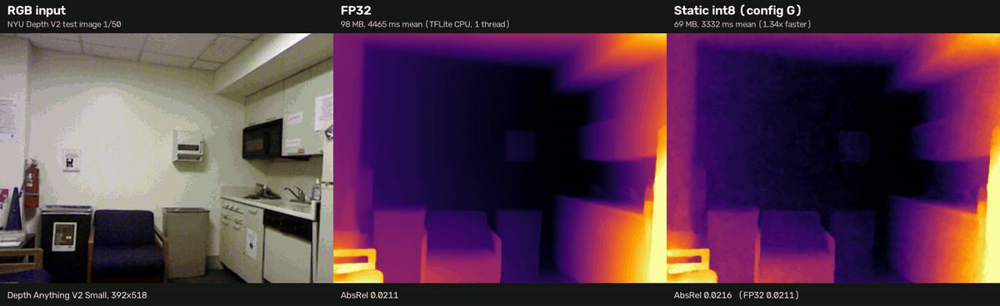

# Depth Anything V2 Small on a phone

**Full static int8 breaks Depth Anything V2 Small (NYU AbsRel 0.055 → 0.235).** The damage comes from LayerNorm, attention and the residual stream, where the DINOv2 encoder carries a persistent outlier channel. The fully connected layers tolerate int8. **Keeping those parts in FP32 and quantizing only the FC layers of the tolerant blocks, plus the depth head, costs only +0.003 AbsRel and runs 1.34× faster on a phone CPU.**

[Depth Anything V2 Small](https://github.com/DepthAnything/Depth-Anything-V2) (ViT-S) was run on an Android phone (realme 12 Pro+, Snapdragon 7s Gen 2) with ONNX Runtime, ExecuTorch and TFLite. It was then quantized two ways: dynamic-range int8, and static int8 with a search over which parts of the network can be int8.

| Model | Size | AbsRel ↓ | δ1 ↑ | Phone CPU latency | Speedup |
|---|---|---|---|---|---|
| FP32 | 98 MB | 0.0550 | 0.9695 | 4465 ms | 1.00× |
| **Dynamic-range int8** | 26 MB | 0.0576 | 0.9667 | 2531 ms | **1.70×** |
| **Static int8, config G** (head + FC of blocks 1, 2, 9, 11) | 69 MB | 0.0580 | 0.9677 | 3332 ms | **1.34×** |
| Static int8, config J (head + FC of all blocks) | 25 MB | 0.0646 | 0.9596 | 2325 ms | 1.92× |
| Full static int8 | 25 MB | 0.2348 | 0.5774 | 1898 ms | 2.35× |

- **Accuracy** is measured on the phone, on all 654 images of the NYU Depth V2 test split (TFLite CPU, 4 threads). FP32 scores the same at 1 and 4 threads, and dynamic int8 within 0.0001 AbsRel. Static int8 shifts slightly with the thread count (config G on the first 50 images: AbsRel 0.0692 at 1 thread, 0.0697 at 4).
- **Latency** is the phone's mean per image (TFLite, 1 thread, 50 test images).

## Demo

Each frame shows RGB input | FP32 depth | quantized depth, with both depth maps computed on the phone (TFLite CPU). The two depth panels share one color scale (brighter = closer), and each panel shows that image's AbsRel.

**Dynamic-range int8** (1.70× faster)


**Static int8, config G** (1.34× faster)



The GIFs show the first 12 test images. The full videos (50 images, 33 s, 1920×588) are [demo_dynamic_int8.mp4](demo/demo_dynamic_int8.mp4) and [demo_static_G.mp4](demo/demo_static_G.mp4).

## What breaks int8, and why

All quantization is post-training. Calibration uses 200 images from the NYU train split. To find where full int8 loses accuracy, parts of the network were kept in FP32 and the error of the final output vs FP32 was measured on train images:

- **By op type and graph role:** keeping LayerNorm in FP32 halves the error (0.53 → 0.27). Adding the attention core (QK^T, softmax, attn·V) brings it to 0.15, and adding GELU and the residual adds brings it to 0.10. The FC and CONV layers barely matter: alone in int8, they add little error.
- **By position:** each of the 12 ViT blocks and the DPT head was switched to int8 alone. Blocks 1, 2, 9, 11 and the head tolerate it (error 0.03–0.08); blocks 3–5 are fragile (0.20–0.29). The errors add up quickly, so plain "first half FP32, second half int8" splits don't work (error 0.15–0.59).
- **Per-layer statistics mislead here.** TF's quantization debugger flags LayerNorm's RSQRT, but keeping that op, or even the 40 worst layers, in FP32 doesn't help (AbsRel stays at about 0.20).

**The cause is a persistent outlier channel in the residual stream.** [`scripts/outlier_stats.py`](scripts/outlier_stats.py) measures activations in each block on 8 train images:

| | Residual stream (block output) | FC inputs (LayerNorm outputs) |
|---|---|---|
| Channel outliers: largest channel / median channel | **8–18×** in blocks 2–10, always **channel 278** | 3–7× (block 0's fc1 input: 14×) |
| Token outliers: largest token norm / median token norm | ≤ 3.5×, no tokens above 10×; in blocks 2–10 the largest is the CLS token | – |

A single int8 scale per tensor has to cover channel 278, so the remaining channels lose most of their resolution. That happens in the residual adds and in LayerNorm, which sees the raw residual stream. After LayerNorm the channels are much more even, which is why the FC layers quantize well. Configs G–J follow from this: FC layers in int8, and LayerNorm, attention, GELU and residual adds in FP32.

int16 activations would be the usual fix, but TF 2.16's 16×8 converter fails on this model ("Expected bias tensor to be a vector").

## Related work and next steps

The outliers found here match known results on transformer quantization:

- **[LLM.int8()](https://arxiv.org/abs/2208.07339)** (Dettmers et al., 2022) found a few fixed feature dimensions with huge values in transformer activations and handled them in higher precision. Channel 278 is the same kind of outlier.
- **[FQ-ViT](https://arxiv.org/abs/2111.13824)** (Lin et al., 2022) and **[RepQ-ViT](https://arxiv.org/abs/2212.08254)** (Li et al., 2023) target exactly the operations that break here. FQ-ViT handles LayerNorm inputs with large differences between channels, using power-of-two scale factors per channel. RepQ-ViT quantizes post-LayerNorm activations per channel, folds those scales into LayerNorm and the next layer, and uses a log-scale quantizer for softmax outputs.
- **[SmoothQuant](https://arxiv.org/abs/2211.10438)** (Xiao et al., 2023) moves activation outliers into the weights of the following linear layer. Here the FC inputs are already fairly even (3–7×), so it would mostly help block 0's fc1.
- **[Vision Transformers Need Registers](https://arxiv.org/abs/2309.16588)** (Darcet et al., 2024) showed that large DINOv2 models produce a few high-norm "artifact" tokens. ViT-S here shows none (no token above 3.5× the median), so the outliers in this model are per-channel, not per-token.

Next steps, roughly in order of effort:
1. Keep only the residual stream and LayerNorm at int16 and everything else at int8, using a per-op quantization tool (for example Google's AI Edge Quantizer) instead of TF 2.16's all-or-nothing 16×8 mode.
2. Apply FQ-ViT / RepQ-ViT-style per-channel handling of LayerNorm to bring those ops to int8 too.
3. Quantization-aware fine-tuning on depth data, if post-training methods fall short.
4. Raise GPU coverage. The TFLite GPU delegate currently accepts only about 80 of the 621 ops (it rejects 2-D GATHER and some RESHAPE/TRANSPOSE shapes), so the GPU path is mostly CPU time.

## Detailed results

The accuracy bar is AbsRel within +0.005 and δ1 within −0.01 of FP32.

### FP32 on the phone

Accuracy is on all 654 test images (4 threads). Latency is the mean at 1 thread on the first 50 test images, with all backends in one session.

| Backend | Model | AbsRel | δ1 | Latency |
|---|---|---|---|---|
| ONNX Runtime 1.20 (CPU) | `_exact_gelu.onnx` | 0.0550 | 0.9695 | 4832 ms |
| ExecuTorch 1.5.1 (XNNPACK) | `_xnnpack.pte` | 0.0550 | 0.9695 | 4694 ms |
| TFLite CPU (XNNPack) | `_fp32.tflite` | 0.0550 | 0.9695 | 4465 ms |
| TFLite GPU delegate | `_fp32.tflite` | 0.0550\* | 0.9695 | 3925 ms |

All backends match PyTorch FP32 (AbsRel 0.0550, δ1 0.9695). ExecuTorch runs the `.pth` directly, and its output matches PyTorch to about 1e-6. FP16 weights score the same as FP32.

### Dynamic-range int8

The FC and CONV weights are stored as int8. Activations stay float, and each FC/CONV input is converted to int8 at run time, using the actual range of that tensor for that image. No calibration is needed.

On all 654 images it adds +0.0026 AbsRel and −0.0028 δ1, so it's within the bar. It runs 1.70× faster on the phone CPU and is 3.8× smaller.

### Static int8 configs

Every op is either FP32 or int8 with fixed, calibrated scales. Accuracy is on all 654 test images on the phone. Latency is the phone mean at 1 thread, with all configs timed in one session.

| | int8 part (the rest is FP32) | Size | AbsRel | δ1 | Phone CPU | Speedup | Within bar |
|---|---|---|---|---|---|---|---|
| A | nothing (FP32) | 98 MB | 0.0550 | 0.9695 | 4465 ms | 1.00× | – |
| **G** | **head + FC of blocks 1, 2, 9, 11** | 69 MB | **0.0580** | **0.9677** | **3332 ms** | **1.34×** | ✅ |
| I | head + FC of all blocks but 3, 4, 5 | 41 MB | 0.0629 | 0.9611 | 2692 ms | 1.66× | ❌ |
| J | head + FC of all 12 blocks | 25 MB | 0.0646 | 0.9596 | 2325 ms | 1.92× | ❌ |
| K | everything | 25 MB | 0.2348 | 0.5774 | 1898 ms | 2.35× | ❌ |

In the "FC" configs, only each block's four fully connected layers (qkv, proj, fc1, fc2) are int8; that block's LayerNorm, attention, GELU and residual adds stay FP32. G is the fastest config within the bar (+0.0030 AbsRel, −0.0018 δ1). I and J trade +0.008 and +0.010 AbsRel for 1.66× and 1.92×.

Other configs were tried and dropped, because G or I beats them. The whole-block configs (head, block 1 + head, blocks 1–2, blocks 1–2 + head) are slower than G, for little or no accuracy gain. A variant between G and I (FC of all blocks but 3, 4, 5, 8, 10) is slower than I at about the same accuracy.

## Models

**Download the models from [Google Drive](https://drive.google.com/drive/folders/1zddM77epoeOX4ZCveJSLId0UKR9KGgEk?usp=sharing).** They aren't stored in this repo because of their size. Put them in a `models/` folder at the repo root. All of them use a fixed **1×392×518×3 float32** input (NHWC; NCHW for ONNX/.pte), normalized as `(RGB/255 − ImageNet mean) / std`. The output is **1×392×518 relative inverse depth** (larger = closer).

| File | What it is |
|---|---|
| `depth_anything_v2_vits_392x518_exact_gelu.onnx` | FP32 ONNX, exact (erf) GELU |
| `depth_anything_v2_vits_392x518_tanh_gelu.onnx` | FP32 ONNX, tanh GELU (the source of every TFLite model) |
| `depth_anything_v2_vits_392x518_xnnpack.pte` | FP32 ExecuTorch, XNNPACK |
| `depth_anything_v2_vits_392x518_fp32.tflite` | FP32 TFLite (builtin ops only, no Flex) |
| `depth_anything_v2_vits_392x518_fp16.tflite` | FP16 weights |
| `depth_anything_v2_vits_392x518_dynamic_int8.tflite` | dynamic-range int8 |
| `depth_anything_v2_vits_392x518_static_{G,I,J}.tflite` | static mixed int8 configs from the table |
| `depth_anything_v2_vits_392x518_static_K_full_int8.tflite` | full static int8 (not accurate; for reference) |

Every TFLite model keeps a float32 input and output, so it's a drop-in replacement for the FP32 one.

## Reproduce

```bash
git clone https://github.com/DepthAnything/Depth-Anything-V2
wget https://huggingface.co/depth-anything/Depth-Anything-V2-Small/resolve/main/depth_anything_v2_vits.pth
wget http://horatio.cs.nyu.edu/mit/silberman/nyu_depth_v2/nyu_depth_v2_labeled.mat
wget http://horatio.cs.nyu.edu/mit/silberman/indoor_seg_sup/splits.mat
```

1. **PyTorch FP32 reference and ONNX export** (`requirements/reference.txt`):
   ```bash
   python scripts/phase1_baseline.py --gt raw   # NYU test split, FP32 reference outputs
   python scripts/pt2onnx.py --gelu tanh        # -> models/depth_anything_v2_vits_392x518_tanh_gelu.onnx
   ```
2. **ExecuTorch** (`requirements/executorch.txt`):
   ```bash
   python scripts/pt2pte.py
   ```
3. **Data for TFLite and quantization** (run from `quantization/`):
   ```bash
   cd quantization
   python make_calib.py   --nyu_mat ../nyu_depth_v2_labeled.mat --splits ../splits.mat   # 200 train images
   python prepare_test.py --nyu_mat ../nyu_depth_v2_labeled.mat --splits ../splits.mat   # first 50 test images
   python prepare_test.py --nyu_mat ../nyu_depth_v2_labeled.mat --splits ../splits.mat -n 654   # full test split
   ```
4. **TFLite conversion and quantization** (`requirements/tflite.txt`, still in `quantization/`):
   ```bash
   onnx2tf -i ../models/depth_anything_v2_vits_392x518_tanh_gelu.onnx -o saved_model -osd   # FP32 + FP16
   python quantize_tflite.py dynamic int8      # dynamic-range int8, full int8
   python layer_sensitivity.py                 # calibrate once -> calibrated.tflite (+ per-layer stats)
   python graph_tags.py                        # tag ops by role + by ViT block / head -> roles.json, stages.json
   python build_static.py                      # configs G, I (and a dropped variant between them)
   python make_mixed.py --name all_fc --roles layernorm,attention,gelu,residual   # config J
   python eval_tflite_nyu.py depth_anything_v2_vits_392x518_*.tflite   # AbsRel / delta vs GT + error vs FP32
   python eval_tflite_nyu.py --test test654 depth_anything_v2_vits_392x518_*.tflite   # same, all 654 images
   ```
   `make_calib.py` also writes the sample file that onnx2tf otherwise downloads, so run it before `onnx2tf`.
   `roles.json` and `stages.json` are already included, so `graph_tags.py` is only needed if you recalibrate.
   With the included files, `build_static.py` and `make_mixed.py` rebuild G, I and J byte for byte.

   The scripts name their outputs after the configs. The downloaded file names map as follows:

   | Downloaded file suffix | Script output suffix |
   |---|---|
   | `_dynamic_int8` | `_dynamic` |
   | `_static_G` | `_st_fcint8_tolerant_head` |
   | `_static_I` | `_st_fcint8_no345_head` |
   | `_static_J` | `_mixed_all_fc` |
   | `_static_K_full_int8` | `_int8` |

5. **Outlier analysis** (`requirements/reference.txt`, from the repo root):
   ```bash
   python scripts/outlier_stats.py
   ```

The search experiments that led to these configs (sensitivity by op type, by role and by block, plus the static + dynamic hybrids) are not part of this repo.

Every accuracy and latency number in this README was measured on the phone, with a separate C++ benchmark app that is not part of this repo. It uses the same preprocessing and metrics as `eval_tflite_nyu.py`. For FP32 and dynamic int8, a laptop run of `eval_tflite_nyu.py` matches the phone within 0.0002 AbsRel. For static int8, the laptop's x86 int8 kernels round differently from the phone's ARM ones, so laptop numbers can be off by up to about 0.003 AbsRel.

## Metrics

The prediction (relative disparity) is aligned to ground truth with a least-squares scale + shift. It's scored on the Eigen crop (rows 45–470, cols 41–600), for depths of 0.001–10 m, against raw sensor depth.

- **AbsRel:** mean |pred − gt| / gt.
- **δk:** the share of pixels with max(pred/gt, gt/pred) < 1.25^k.

## Credits and licenses

- **Depth Anything V2** by Yang et al. ([paper](https://arxiv.org/abs/2406.09414), [code](https://github.com/DepthAnything/Depth-Anything-V2)). The Small model is released under Apache-2.0. The converted models here are derivatives of it and keep that license.
- **NYU Depth V2** by Silberman et al. ([dataset](https://cs.nyu.edu/~fergus/datasets/nyu_depth_v2.html)). It's used for evaluation and calibration, and the demo shows test-split images. The dataset itself is not redistributed here.
