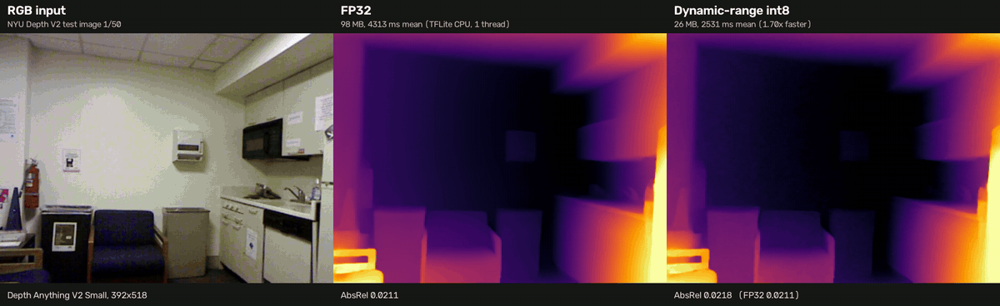

# Depth Anything V2 Small on a phone: FP32 vs ExecuTorch vs dynamic and static int8 quantization

[Depth Anything V2 Small](https://github.com/DepthAnything/Depth-Anything-V2) (ViT-S) was run on an Android phone (realme 12 Pro+, Snapdragon 7s Gen 2) and quantized in two ways: dynamic-range int8, and static int8. For static int8, a search found which parts of the network can be int8 and which must stay FP32. Every model is scored on the NYU Depth V2 test split and timed on the device.

**Main results** (TFLite, 1 CPU thread, first 50 NYU test images, mean latency per image):

| Model | Size | AbsRel ↓ | δ1 ↑ | CPU latency | Speedup |
|---|---|---|---|---|---|
| FP32 | 98 MB | 0.0667 | 0.9462 | 4465 ms | 1.00× |
| **Dynamic-range int8** | 26 MB | 0.0680 | 0.9448 | 2531 ms\* | **1.70×** |
| **Static int8, config G** (head + FC of blocks 1, 2, 9, 11) | 69 MB | 0.0692 | 0.9468 | 3332 ms | **1.34×** |
| Static int8, config J (head + all FC layers) | 25 MB | 0.0774 | 0.9386 | 2325 ms | 1.92× |
| Full static int8 | 25 MB | 0.2068 | 0.6534 | 1898 ms | 2.35× |

\* Dynamic-range int8 was timed in a separate session. Its speedup is relative to that session's FP32 mean (4313 ms).

## Demo

Each frame shows RGB input | FP32 depth | quantized depth. The two depth panels share one color scale (brighter = closer), and each panel shows that image's AbsRel.

**Dynamic-range int8** (1.70× faster, AbsRel 0.0678 vs 0.0666)



**Static int8, config G** (1.34× faster, AbsRel 0.0700 vs 0.0666)


The GIFs show the first 12 images. The full videos (50 images, 33 s, 1920×588) are [demo_dynamic_int8.mp4](demo/demo_dynamic_int8.mp4) and [demo_static_G.mp4](demo/demo_static_G.mp4).

## Results

The accuracy bar used here is AbsRel within +0.005 and δ1 within −0.01 of FP32.

### FP32 on the device

1 thread, 50 test images, all four backends in one run:

| Backend | Model | AbsRel | δ1 | Mean latency |
|---|---|---|---|---|
| ONNX Runtime 1.20 (CPU) | `_exact_gelu.onnx` | 0.0667 | 0.9462 | 4832 ms |
| ExecuTorch 1.5.1 (XNNPACK) | `_xnnpack.pte` | 0.0667 | 0.9462 | 4694 ms |
| TFLite CPU (XNNPack) | `_fp32.tflite` | 0.0667 | 0.9462 | 4465 ms |
| TFLite GPU delegate | `_fp32.tflite` | 0.0667 | 0.9462 | 3925 ms |

- **ExecuTorch runs the `.pth` directly,** and its output matches PyTorch to about 1e-6.
- **On the full test set (654 images, 4 threads),** every backend scores AbsRel 0.0550 and δ1 0.9695, the same as PyTorch.
- **The GPU delegate accepts only about 80 of the 621 ops.** It rejects 2-D GATHER and some RESHAPE/TRANSPOSE shapes, so "GPU" here is mostly CPU time.

### Dynamic-range int8

The FC and CONV weights are stored as int8. Activations stay float, and each FC/CONV input is converted to int8 at run time, using the actual range of that tensor for that image. LayerNorm, softmax, GELU and the residual adds stay float.

- **Accuracy:** AbsRel +0.0013 and δ1 −0.0014, so within the bar.
- **Speed and size:** 1.70× faster on CPU (2531 vs 4313 ms, mean), 3.8× smaller.

### Static int8

Every op is either FP32 or int8 with fixed scales, calibrated on 200 images from the NYU train split.

- **Full int8 fails** (AbsRel 0.2068).
- **Searching by op type and by graph role** showed that LayerNorm, the attention core (softmax and the attention matmuls) and the residual stream cause the damage. The FC and CONV layers tolerate int8 well.
- **Searching by position:** each of the 12 ViT blocks and the DPT head was switched to int8 alone. Blocks 1, 2, 9, 11 and the head tolerate it; blocks 3–5 are fragile. Errors add up quickly, so plain "first half FP32, second half int8" splits don't work.
- **What works:** put only the FC layers in int8, and only in the blocks that tolerate it.

All configs were timed in one session (mean latency):

| | int8 part (the rest is FP32) | Size | AbsRel | δ1 | CPU | CPU speedup | Within bar |
|---|---|---|---|---|---|---|---|
| A | nothing (FP32) | 98 MB | 0.0667 | 0.9462 | 4465 ms | 1.00× | – |
| C | DPT head | 91 MB | 0.0678 | 0.9438 | 3817 ms | 1.17× | ✅ |
| D | block 1 + head | 85 MB | 0.0689 | 0.9433 | 3622 ms | 1.23× | ✅ |
| F | blocks 1–2 + head | 80 MB | 0.0730 | 0.9357 | 3506 ms | 1.27× | ❌ |
| **G** | **head + FC of blocks 1, 2, 9, 11** | 69 MB | **0.0692** | **0.9468** | **3332 ms** | **1.34×** | ✅ |
| H | head + FC of all blocks but 3, 4, 5, 8, 10 | 52 MB | 0.0752 | 0.9393 | 2766 ms | 1.61× | ❌ |
| I | head + FC of all blocks but 3, 4, 5 | 41 MB | 0.0758 | 0.9387 | 2692 ms | 1.66× | ❌ |
| J | head + FC of all 12 blocks | 25 MB | 0.0774 | 0.9386 | 2325 ms | 1.92× | ❌ |
| K | everything | 25 MB | 0.2068 | 0.6534 | 1898 ms | 2.35× | ❌ |

In the "FC" configs, only each block's four fully connected layers are int8; that block's LayerNorm, attention, GELU and residual adds stay FP32.

The underlying cause is that the DINOv2 activations have large outliers. A single fixed int8 scale per tensor can't cover them without losing the small values. int16 activations would be the usual fix, but TF 2.16's 16×8 converter fails on this model.

## Models

**Download the models from [Google Drive](https://drive.google.com/drive/folders/1zddM77epoeOX4ZCveJSLId0UKR9KGgEk?usp=sharing).** They aren't stored in this repo because of their size (650 MB in total). Put them in a `models/` folder at the repo root. All of them use a fixed **1×392×518×3 float32** input (NHWC; NCHW for ONNX/.pte), normalized as `(RGB/255 − ImageNet mean) / std`. The output is **1×392×518 relative inverse depth** (larger = closer).

| File | What it is |
|---|---|
| `depth_anything_v2_vits_392x518_exact_gelu.onnx` | FP32 ONNX, exact (erf) GELU |
| `depth_anything_v2_vits_392x518_tanh_gelu.onnx` | FP32 ONNX, tanh GELU (the source of every TFLite model) |
| `depth_anything_v2_vits_392x518_xnnpack.pte` | FP32 ExecuTorch, XNNPACK |
| `depth_anything_v2_vits_392x518_fp32.tflite` | FP32 TFLite (builtin ops only, no Flex) |
| `depth_anything_v2_vits_392x518_fp16.tflite` | FP16 weights |
| `depth_anything_v2_vits_392x518_dynamic_int8.tflite` | dynamic-range int8 |
| `depth_anything_v2_vits_392x518_static_{G,H,I,J}.tflite` | static mixed int8 configs from the table |
| `depth_anything_v2_vits_392x518_static_K_full_int8.tflite` | full static int8 (not accurate; for reference) |

Every TFLite model keeps a float32 input and output, so it's a drop-in replacement for the FP32 one.

## Reproduce

```bash
git clone https://github.com/DepthAnything/Depth-Anything-V2
wget https://huggingface.co/depth-anything/Depth-Anything-V2-Small/resolve/main/depth_anything_v2_vits.pth
wget http://horatio.cs.nyu.edu/mit/silberman/nyu_depth_v2/nyu_depth_v2_labeled.mat
wget http://horatio.cs.nyu.edu/mit/silberman/indoor_seg_sup/splits.mat
```

1. **PyTorch FP32 reference and ONNX export** (`requirements/reference.txt`):
   ```bash
   python scripts/phase1_baseline.py --gt raw   # NYU test split, FP32 reference outputs
   python scripts/pt2onnx.py --gelu tanh        # -> models/depth_anything_v2_vits_392x518_tanh_gelu.onnx
   ```
2. **ExecuTorch** (`requirements/executorch.txt`):
   ```bash
   python scripts/pt2pte.py
   ```
3. **Data for TFLite and quantization** (run from `quantization/`):
   ```bash
   cd quantization
   python make_calib.py   --nyu_mat ../nyu_depth_v2_labeled.mat --splits ../splits.mat   # 200 train images
   python prepare_test.py --nyu_mat ../nyu_depth_v2_labeled.mat --splits ../splits.mat   # first 50 test images
   ```
4. **TFLite conversion and quantization** (`requirements/tflite.txt`, still in `quantization/`):
   ```bash
   onnx2tf -i ../models/depth_anything_v2_vits_392x518_tanh_gelu.onnx -o saved_model -osd   # FP32 + FP16
   python quantize_tflite.py dynamic int8      # dynamic-range int8, full int8
   python layer_sensitivity.py                 # calibrate once -> calibrated.tflite (+ per-layer stats)
   python graph_tags.py                        # tag ops by role + by ViT block / head -> roles.json, stages.json
   python build_static.py                      # configs G, H, I
   python make_mixed.py --name all_fc --roles layernorm,attention,gelu,residual   # config J
   python eval_tflite_nyu.py depth_anything_v2_vits_392x518_*.tflite   # AbsRel / delta vs GT + error vs FP32
   ```
   `make_calib.py` also writes the sample file that onnx2tf otherwise downloads, so run it before `onnx2tf`.
   `roles.json` and `stages.json` are already included, so `graph_tags.py` is only needed if you recalibrate.
   With the included files, `build_static.py` and `make_mixed.py` rebuild G, H, I and J byte for byte.

   The scripts name their outputs after the configs. The downloaded file names map as follows:

   | Downloaded file suffix | Script output suffix |
   |---|---|
   | `_dynamic_int8` | `_dynamic` |
   | `_static_G` | `_st_fcint8_tolerant_head` |
   | `_static_H` | `_st_fcint8_safe_head` |
   | `_static_I` | `_st_fcint8_no345_head` |
   | `_static_J` | `_mixed_all_fc` |
   | `_static_K_full_int8` | `_int8` |

The search experiments that led to these configs (sensitivity by op type, by role and by block, plus the static + dynamic hybrids) are not part of this repo.

The on-device numbers come from a separate C++ benchmark app, which is not part of this repo. It used the same preprocessing and metrics as `eval_tflite_nyu.py`, and host and device agree to about 0.001 AbsRel.

## Metrics

The prediction (relative disparity) is aligned to ground truth with a least-squares scale + shift. It's scored on the Eigen crop (rows 45–470, cols 41–600), for depths of 0.001–10 m, against raw sensor depth.

- **AbsRel:** mean |pred − gt| / gt.
- **δk:** the share of pixels with max(pred/gt, gt/pred) < 1.25^k.

## Credits and licenses

- **Depth Anything V2** by Yang et al. ([paper](https://arxiv.org/abs/2406.09414), [code](https://github.com/DepthAnything/Depth-Anything-V2)). The Small model is released under Apache-2.0. The converted models here are derivatives of it and keep that license.
- **NYU Depth V2** by Silberman et al. ([dataset](https://cs.nyu.edu/~fergus/datasets/nyu_depth_v2.html)). It's used for evaluation and calibration, and the demo shows test-split images. The dataset itself is not redistributed here.